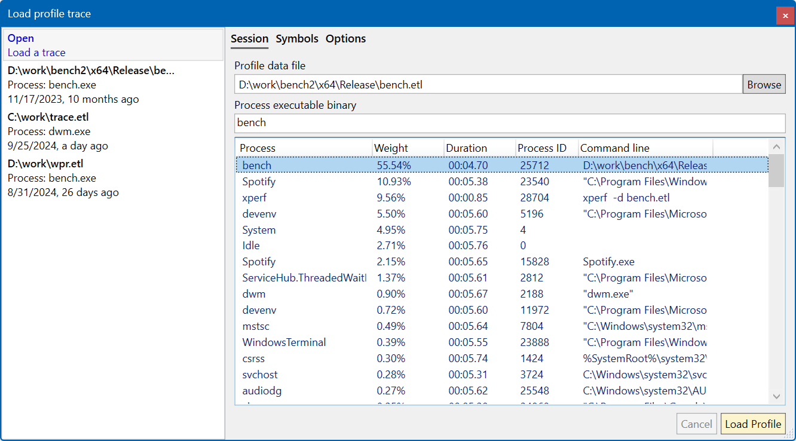
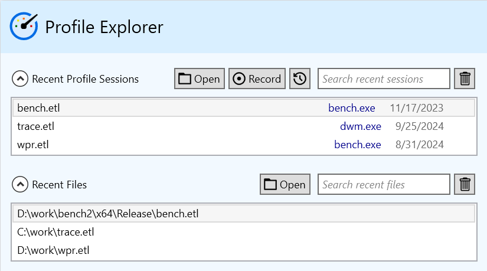
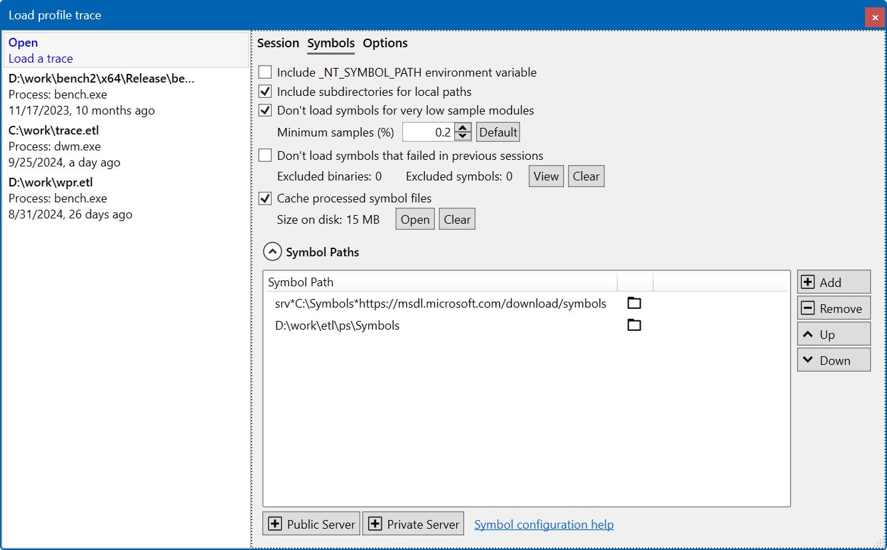
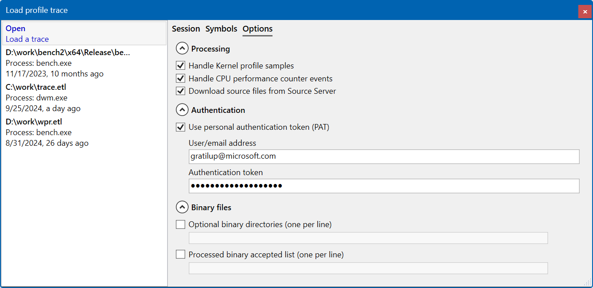

#### Loading a new trace

There are several ways to open a new ETW trace file (*.etl):

- Use the **Open** button in the *Start Page* displayed on startup.
- Use the **Profiling** -> **Load Profile** menu.
- Use the **Ctrl+O** keyboard shortcut.

Once the trace file is selected in the *Open File dialog*, the **Load profile trace** window is displayed. It lists the processes (applications) that are captured in the trace, sorted by weight (number of samples).

{:target="_blank"}

From the list, select the process you want to analyze and *click* the **Load Profile** button (alternatively, *double-click* or press the *Return* key).  

The selected process is loaded from the trace file, any required binary and symbol files are downloaded and the profiling data is analyzed. Once loading is completed, the window closes and the profiling views are populated, as described in [Profiling UI overview](profiling-ui.md).

???+ note
    If the trace fails to load, the *Profiling Trace Report* windows is automatically opened. The *Modules tab* lists the modules referenced by the trace and indicates whether the binary and debug info symbols could be found and loaded. See the [Profiling Trace report](trace-overview.md) page for more details.

#### Loading a previously opened trace

Previously opened traces are saved as sessions. Recent sessions can be quickly opened again for the same process using either the *Start page* or the session list on the left of the *Load profile trace* window (*double-click* an entry or press the *Return* key).

{:target="_blank"}

#### Attaching an SPT profile (preview)

Use **Profiling** -> **Attach SPGO Profile...** to select a sample profile-guided optimization profile for a binary. The command is available for binaries opened directly and modules in an ETL session, including modules whose binary files have not been downloaded yet. It is disabled when there is no binary or module in the session.

The menu opens the attachment dialog directly. Choose **Browse...** beside **SPGO profile** to select an `.spt` file. The target defaults to the active assembly tab's binary, the selected Summary module, or the sole available binary. Ambiguous targets require an explicit selection.

Selecting an SPT file automatically starts validation. The **Validation** area displays progress, a summary of loaded records, or an actionable error. **Show details** expands the GUID/age comparisons, tool version, and detailed counts. Use **Browse...** again to replace the profile without closing the dialog; changing inputs clears the old validation result.

The dialog automatically locates the externally installed MSVC **SPTDump.exe** using a configured override, PATH, then Visual Studio/MSVC installation locations. No confirmation is needed when detection succeeds. The **Symbols and tools** section is initially collapsed and expands automatically when tool discovery or PDB validation needs attention. **Change...** selects and remembers an executable; **Auto-detect** clears that override. **Retry validation** reruns the checks. The tool is not bundled or downloaded. See [SPTDump documentation](https://learn.microsoft.com/en-us/cpp/build/sptdump).

SPTDump reads the file asynchronously, retaining IP/PMC samples, LBR records, call stacks, and repetition weights without interpreting them as execution time. Parsing errors and unsupported records are reported before attachment. The target binary must already be available locally and have a CodeView GUID and age matching a program in the SPT. A PDB is optional; if supplied, it must also match the binary. The dialog never discovers or downloads binaries or symbols.

**Attach** is enabled only after parsing and identity validation succeed. It rechecks the input files for changes, then retains the prepared SPT in session memory, replacing any previous SPT for that target. The original multi-program data and matching program IDs are retained. The data is not saved with sessions and is discarded when the session ends. **Cancel** discards the pending result.

This preview does not map samples onto functions, annotate assembly/source/graphs, or change an existing ETL profile. The status bar confirms that the SPT is loaded and validated in memory, but SPGO visualization is not implemented yet.

#### Symbols configuration

Symbols are the binary (EXE/DLL) and debug info (PDB) files required to analyze the processes recorded in a trace. The binaries are used to disassembly individual functions and the debug files are used to resolve function names and provide the source file and line number information.

{:target="_blank"}

##### Symbol paths

Symbols are searched in the locations indicated by the **Symbol Paths** list, found in the **Symbols** tab of the *Load profile trace* window. Symbol locations can be of two types:  

- Paths to local directories or network file shares.  
- Symbol server URLs. By default, the [Microsoft public symbol server](https://learn.microsoft.com/en-us/windows-hardware/drivers/debugger/microsoft-public-symbols) is added to the list, with a local download cache directory at *C:\Symbols*.
  
!!! note
    More info about symbol servers and the symbol path syntax is available here:  
    [https://learn.microsoft.com/en-us/windows/win32/debug/using-symsrv](https://learn.microsoft.com/en-us/windows/win32/debug/using-symsrv)

##### Missing debug info symbols

When the debug info symbols (PDB file) for a module cannot be found, the names of the functions used by the app during the trace are replaced by their *Relative virtual address* (RVA) as a hexadecimal value (*127F* for example).  

You can use the logs from the [Trace view report](trace-overview.md) to understand why symbols could not be found, such as using wrong local directory paths or a symbol server being unreachable.

##### Additional symbol options

| Option | Description |
| ------ | ------------|
| Include __NT__SYMBOL__PATH environment variable | Append the environment variable's value to the list of searched symbol paths. |
| Include subdirectories for local paths | Consider symbols in sub-directories up to 3 levels deep for the local directories in the *Symbols Paths* list. |
| Don't load symbols for very low sample modules | Skip downloading and loading of symbols for modules with a low number of samples. This helps reduce download time for processes with many modules, where the majority have few relevant samples.   A module is skipped if it has fewer samples than a threshold. This threshold can be configured using the *Minimum samples* field as a percentage of the total number of samples. |
| Don't load symbols that failed in previous sessions | Skip downloading and loading of symbols that could not be found in previous sessions (for example, due to offline symbol servers). The list of skipped symbols can be viewed and cleared. |
| Cache processed symbol files | Cache the processed debug symbol files and use them to speed up loading of traces requiring the same symbols. The cache files are saved in the temporary directory and can be viewed and cleared. |

#### Trace processing options

{:target="_blank"}

| Option | Description |
| ------ | ------------|
| Handle Kernel profile samples | Include samples executing in the kernel context and connect the call stacks between kernel and user mode code. |
| Handle CPU performance counter samples | Process CPU performance counter (PMC) events and display them in the Summary, Assembly and *Source File* views using additional columns. |
| Download source files from Source Server | Automatically attempt to download source files from the location indicated by the debug info file. If the download URL requires authentication, it can be configured in the Authentication section found below. |

##### Authentication

Authentication using an user/email address and Personal Autehnticaion token (PAT) can be configured for both source file servers and symbol servers.

##### Binary files

Additional local directory paths for searching binary files can be configured. The binary files to process in a trace can be restricted to only the ones in the accepted list.